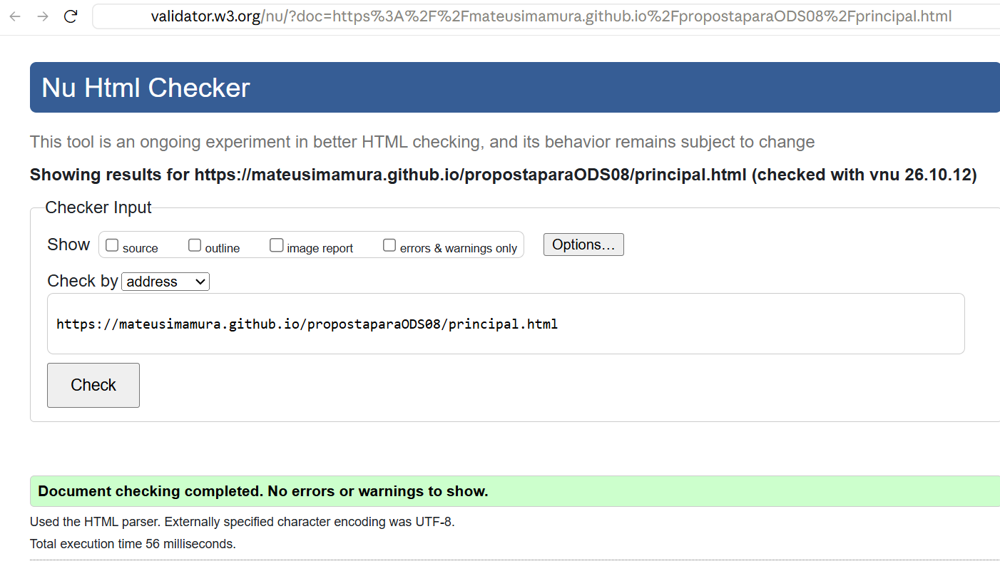
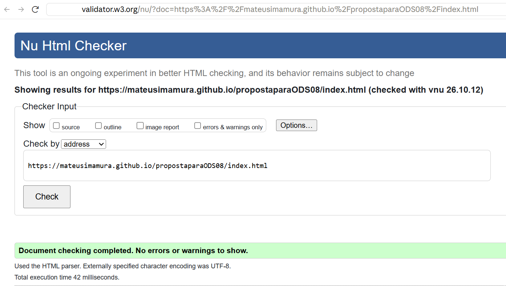
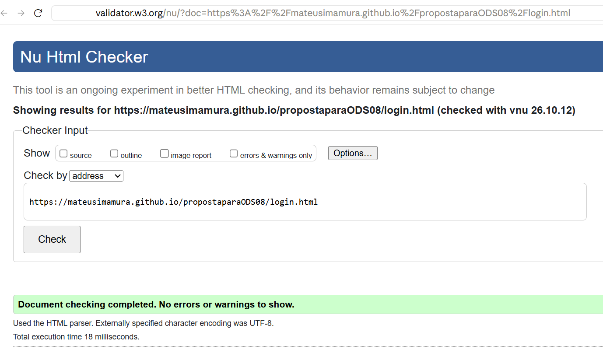
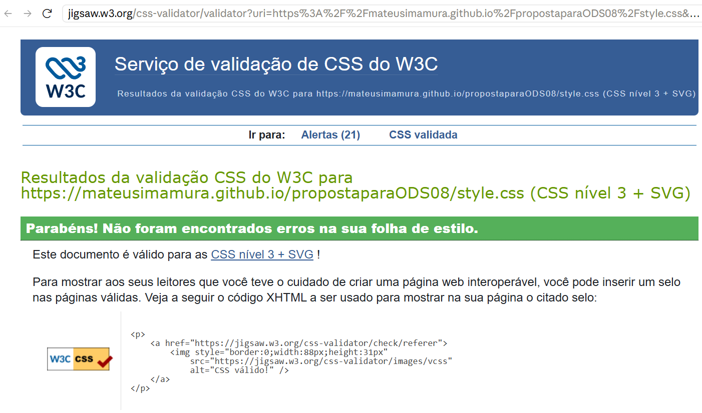

# Proposta ODS 8: Trabalho decente e crescimento econômico

Website desenvolvido para o Projeto 1 da disciplina de **Programação Web Front-End** da **UTFPR**.

**Site publicado:** https://mateusimamura.github.io/propostaparaODS08/

## Sobre o projeto

O site apresenta uma proposta para a geração de empregos alinhada ao **Objetivo de Desenvolvimento Sustentável 8 (ODS 8)** da Agenda 2030 da ONU: *promover o crescimento econômico sustentado, inclusivo e sustentável, emprego pleno e produtivo e trabalho decente para todas e todos*.

O conteúdo está dividido em três etapas:

1. **O Problema:** os distúrbios do mercado que dificultam o trabalho decente (concentração de capital, concentração de mercado e escassez de empregos).
2. **A Proposta:** ações do Estado para corrigir esses distúrbios (tributação progressiva, defesa da concorrência, investimento público, valorização do salário mínimo, qualificação e fiscalização).
3. **Como Participar:** formas de a sociedade contribuir para a proposta.

Além disso, o site oferece um **serviço**: uma rede de **estudantes voluntários** que levam à comunidade oficinas de currículo, orientação sobre direitos trabalhistas e apoio à formalização de MEIs. Os estudantes entram na rede pela página de cadastro.

**Público-alvo:** estudantes universitários e a comunidade local que busca trabalho digno.

## Funcionalidades

- Cadastro com 8 campos (nome, e-mail, telefone, data de nascimento, cidade, instituição, área de interesse e senha) e validação nativa do HTML
- Login com e-mail e senha
- Página principal com menu de navegação, quadros clicáveis e seção sobre a rede de estudantes
- Rodapé com link para o currículo do autor
- Layout responsivo (computador, tablet e celular)
- Animações de entrada e efeitos de hover feitos apenas com CSS

## Fluxo de navegação

```
Cadastro (index.html) → Login (login.html) → Página principal (principal.html)
                                                  ├── O Problema (problema.html)
                                                  ├── A Proposta (proposta.html)
                                                  └── Como Participar (participe.html)
```

## Estrutura do projeto

```
Projeto 1/
├── index.html        # Página de cadastro (entrada do site)
├── login.html        # Página de login
├── principal.html    # Página principal
├── problema.html     # Etapa 1: o problema
├── proposta.html     # Etapa 2: a proposta
├── participe.html    # Etapa 3: como participar
├── curriculo.html    # Currículo do autor
├── style.css         # Estilos de todas as páginas
├── img/              # Imagens e ilustrações (SVG)
│   ├── logo.svg
│   ├── hero.svg
│   ├── problema.svg
│   ├── proposta.svg
│   ├── participe.svg
│   └── estudantes.svg
├── validacoes/       # Prints da validação W3C
│   ├── principal_validacao.png
│   ├── index_val.png
│   ├── login_val.png
│   └── CSS_val.png
└── README.md
```

## Tecnologias

- **HTML5** com tags semânticas (`header`, `nav`, `main`, `section`, `footer`, `form`, `fieldset`, `dl`)
- **CSS3** com variáveis, Flexbox, Grid, animações (`@keyframes`) e media queries
- **Google Fonts:** Inter (textos) e Space Grotesk (títulos)
- Nenhum framework foi utilizado

## Validação

O código foi validado nos validadores oficiais da W3C:

- HTML: [validator.w3.org](https://validator.w3.org/)
- CSS: [jigsaw.w3.org/css-validator](https://jigsaw.w3.org/css-validator/)

Todas as páginas foram validadas sem erros nem avisos no HTML, e a folha de estilo foi validada sem erros no CSS.

### Página principal (HTML)



### Página de cadastro (HTML)



### Página de login (HTML)



### Folha de estilo (CSS)



## Como executar

1. Baixe ou clone este repositório.
2. Abra o arquivo `index.html` no navegador.

## Autor

Projeto desenvolvido individualmente.

| Integrante | Currículo |
|---|---|
| Mateus Massaiti Imamura | [Currículo](https://mateusimamura.github.io/propostaparaODS08/curriculo.html) |
